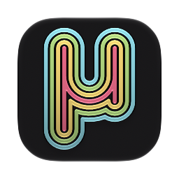
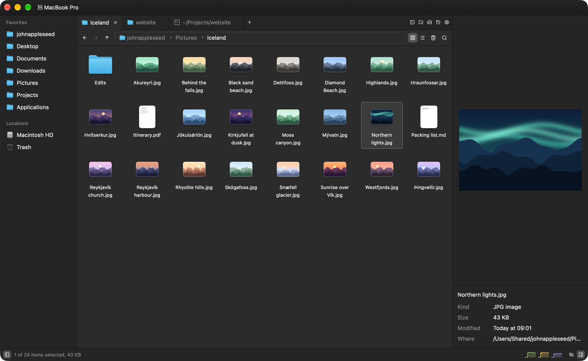

# Mu

Mu is a file manager for macOS, made to be snappier and more intuitive than Finder. Everything responds right away, and you can drive it all from the keyboard. Folders open in tabs, you can type a path into the path bar, and a terminal opens where you are.



## Install

Download `Mu.zip` from the [latest release](https://github.com/sylophi/mu/releases/latest), open it and move Mu to Applications. It keeps itself up to date from there.

Mu needs macOS 27 on a Mac with Apple silicon.

## Features

- Tabs and windows, which open again where they were
- A details list, or a grid with thumbnails, sorted naturally with folders first
- Type-to-select, ⇧-click and ⌘-click selection, and box selection
- A path bar to type into, which completes folder names and suggests the ones you go to most
- Copy, move, rename, compress and extract, with undo and redo for every change
- Folders that merge when copied onto ones with the same name, and a choice for each file that's in the way
- Quick Look, and a preview pane for images, text, documents and folders
- Disk images laid out as Finder shows them, ready to drag the app onto Applications
- A shelf to set files aside while you find where they go
- Terminals as tabs
- An editor that opens text files in place of TextEdit, and find in folder
- Activity, for CPU, GPU, memory, network, disks and processes, and Storage, for what takes up the room
- The Trash with Put Back, disks you can eject, and file servers on the network
- Other apps' Show in Finder can show files in Mu instead
- Light and dark themes that follow the system

## From the command line

`mu` opens a tab in Mu from a shell or a script. Settings → Command line tool installs it.

```sh
mu                  # this folder
mu ~/Downloads      # a folder, or a file selected in its folder
mu terminal         # a terminal here
mu edit notes.md    # the editor
mu find             # find in this folder
mu storage ~        # what takes up the room
mu activity         # or history, or settings
```

Other apps can do the same with a link, like `mu://folder/Users/me/Downloads`.

## Keys

| Action | Key |
| --- | --- |
| Command palette | ⇧⌘P |
| Open / open in new tab / open in editor | ↩ or ⌘↓ / ⌘↩ / ⌘E |
| Back / forward / enclosing folder | ⌘[ / ⌘] / ⌘↑ |
| Go to folder | ⌘L |
| Rename | ⇧↩ or F2 |
| Quick Look | Space |
| Move to Trash | ⌘⌫ |
| Undo / redo | ⌘Z / ⇧⌘Z |
| Filter / find in folder | ⌘F / ⇧⌘F |
| New tab / close tab / reopen closed tab | ⌘T / ⌘W / ⇧⌘T |
| New terminal | ⌃` |
| Grid or list | ⇥ |
| Sidebar / preview / hidden files | ⌘B / ⌘P / ⇧⌘. |

The rest are in the menus and the command palette.

## Building

```sh
make run        # runs Mu
make app        # builds dist/Mu.app
make bench      # times how soon Mu answers, as CI does for each change
```

It needs Rust and Xcode. `make` also applies Mu's patches to GPUI (`patches/`) before it builds, so a plain `cargo` command needs a `make patched` first.

## License

Mu is under the [MIT License](LICENSE). It's made with [GPUI](https://www.gpui.rs), Zed's UI framework, through [GPUI Kit](https://github.com/longbridge/gpui-kit), and the patches in `patches/` change GPUI crates from [Zed](https://github.com/zed-industries/zed), so they're under the Apache License 2.0, as those crates are.

The colors are from [Zedokai](https://github.com/slymax/zedokai) by slymax. The bundled fonts are [JetBrains Mono](https://github.com/JetBrains/JetBrainsMono) (SIL Open Font License) and the Symbols Nerd Font from [Nerd Fonts](https://github.com/ryanoasis/nerd-fonts) (MIT), with their licenses in `assets/fonts`.
